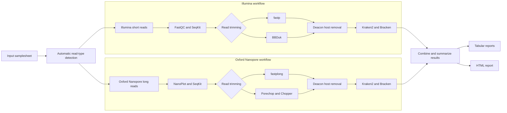

# nf-qcflow

**Nextflow pipeline for NGS read quality control and preprocessing**

`nf-qcflow` is a Nextflow pipeline for quality assessment, preprocessing, host sequence removal, and taxonomic contamination screening of next-generation sequencing (NGS) data.

The pipeline supports both Illumina short-read and Oxford Nanopore long-read data. It automatically identifies the read type from the input samplesheet, so users do not need to specify a sequencing platform parameter.

The workflow generates read statistics, taxonomic classification results, and consolidated reports in tabular and HTML formats.

A [demo of nf-qcflow output](<https://github.com/xiaoli-dong/nf-qcflow>) is available.

## Workflow overview



### Workflow components

| Analysis | Illumina short reads | Oxford Nanopore long reads |
|---|---|---|
| Initial quality assessment | FastQC | NanoPlot |
| Read statistics | SeqKit | SeqKit |
| Read preprocessing | fastp or BBDuk | fastplong or Porechop + Chopper |
| Host sequence removal | Deacon | Deacon |
| Taxonomic classification | Kraken2 and Bracken | Kraken2 and Bracken |

The trimmer used for each read type can be selected through pipeline parameters. Host removal and read preprocessing can also be skipped when appropriate.

## Requirements

- Linux
- [Nextflow](https://www.nextflow.io/) >= 25.10.4
- A supported container runtime, such as Singularity/Apptainer or Docker
- Access to the required reference databases

This pipeline was built using nf-core/tools 4.0.

If you are new to Nextflow, refer to the [Nextflow installation documentation](https://www.nextflow.io/docs/latest/install.html). Before processing actual samples, test your installation using the test profile.

## Quick start

### 1. Clone the repository

```bash
git clone https://github.com/xiaoli-dong/nf-qcflow.git
```

### 2. Check pipeline parameters

Display the available parameters:

```bash
nextflow run path_to/nf-qcflow --help
```

For all available parameters, including hidden parameters:

```bash
nextflow run path_to/nf-qcflow --help_full
```

### 3. Prepare the input samplesheet

The pipeline requires a CSV samplesheet describing the input FASTQ files.

Example: `samplesheet.csv`

```csv
sample,fastq_1,fastq_2,fastq_long
sample_illumina,reads_R1.fastq.gz,reads_R2.fastq.gz,NA
sample_ont,NA,NA,reads.fastq.gz
sample_mixed,shortreads_R1.fastq.gz,shortreads_R2.fastq.gz,longreads.fastq.gz
```

#### Samplesheet columns

| Column | Description |
|---|---|
| `sample` | Unique sample identifier |
| `fastq_1` | Illumina forward reads |
| `fastq_2` | Illumina reverse reads |
| `fastq_long` | Oxford Nanopore long reads |

#### Samplesheet requirements

- The first row must contain the column headers.
- Each row represents one sample.
- The `sample` column must contain a unique sample identifier.
- `fastq_1` and `fastq_2` are reserved for Illumina short reads.
- `fastq_long` is reserved for Oxford Nanopore long reads.
- Use `NA` for missing FASTQ files.
- FASTQ file paths must point to accessible input files.

The pipeline automatically identifies the available read types from the samplesheet. No `--platform` parameter is required.

A sample can contain short-read data, long-read data, or both.

### 4. Run the pipeline

#### Local execution

```bash
nextflow run path_to/nf-qcflow \
    -profile singularity \
    --input samplesheet.csv \
    --outdir results \
    -resume
```

#### HPC execution with Slurm

```bash
nextflow run path_to/nf-qcflow \
    -profile singularity,slurm \
    --input samplesheet.csv \
    --outdir results \
    -resume
```

Replace `singularity` with the appropriate container profile if using another supported container runtime.

The `-resume` option allows Nextflow to reuse successfully completed tasks when restarting an interrupted run.

## Configuration

Pipeline parameters can be supplied through the command line or a Nextflow `-params-file`.

Custom Nextflow configuration files supplied with `-c` should be used for execution settings such as executor configuration, resource allocation, and container settings, rather than pipeline parameters.

For more information, see the [nf-core configuration documentation](https://nf-co.re/docs/usage/configuration).

### Common pipeline parameters

#### Input and output

| Parameter | Type | Description |
|---|---|---|
| `--input` | String | Input samplesheet CSV |
| `--outdir` | String | Output directory |

#### Read preprocessing

| Parameter | Type | Default | Description |
|---|---|---|---|
| `--skip_trimmer_short` | Boolean | `false` | Skip short-read trimming |
| `--skip_trimmer_long` | Boolean | `false` | Skip long-read trimming |
| `--short_trimmer` | String | `fastp` | Short-read trimmer: `fastp` or `bbduk` |
| `--long_trimmer` | String | `fastplong` | Long-read trimmer: `fastplong` or `porechop_chopper` |
| `--adapter_fasta` | String | `null` | User-supplied adapter FASTA file |

#### Host removal

| Parameter | Type | Default | Description |
|---|---|---|---|
| `--skip_dehost` | Boolean | `false` | Skip host sequence removal |

#### Database parameters

| Parameter | Type | Description |
|---|---|---|
| `--kraken2_db` | String | Path to the Kraken2 database |
| `--deacon_refdb` | String | Path to the Deacon reference database |

The default database paths are placeholders and should be updated to the locations of the databases available in your environment.

For the complete list of parameters, run:

```bash
nextflow run path_to/nf-qcflow --help_full
```

## Database requirements

The pipeline requires the following databases:

### Kraken2 database

Kraken2 uses a reference database for taxonomic classification. Bracken uses the Kraken2 database to estimate taxonomic abundance.

Pre-built Kraken2 databases are available from the [Kraken2 database repository](https://benlangmead.github.io/aws-indexes/k2).

For example, to download and extract the Standard 16 GB database:

```bash
wget https://genome-idx.s3.amazonaws.com/kraken/k2_standard_16gb_20250402.tar.gz
tar -xvzf k2_standard_16gb_20250402.tar.gz
```

Set `--kraken2_db` to the extracted database directory.

### Deacon reference database

Deacon is used for host sequence removal.

Refer to the [Deacon repository](https://github.com/mbhall88/deacon) for instructions on obtaining and preparing a reference database.

Set `--deacon_refdb` to the database directory.

## Testing

Before running the pipeline on actual data, test your Nextflow and container setup using the test profile:

```bash
nextflow run path_to/nf-qcflow -profile test,singularity
```

The test profile provides test input data and configuration for checking the workflow execution.

## Help and support

For questions, bug reports, or feature requests, please open an issue in the [nf-qcflow GitHub repository](https://github.com/xiaoli-dong/nf-qcflow).

## Citations

If you use `nf-qcflow` in your research, please cite the relevant tools used in your analysis:

- **FastQC:** Andrews, S. (2010). FastQC: A Quality Control Tool for High Throughput Sequence Data.
- **BBDuk / BBTools:** Bushnell, B. (2014). BBMap: A Fast, Accurate, Splice-Aware Aligner. Lawrence Berkeley National Laboratory, Report LBNL-7065E.
- **fastp:** Chen, S., Zhou, Y., Chen, Y., & Gu, J. (2018). fastp: an ultra-fast all-in-one FASTQ preprocessor. *Bioinformatics*, 34(17), i884–i890.
- **fastplong:** [fastplong repository](https://github.com/OpenGene/fastplong).
- **Porechop:** [Porechop repository](https://github.com/rrwick/Porechop).
- **NanoPlot:** De Coster, W., D'Hert, S., Schultz, D. T., Cruts, M., & Van Broeckhoven, C. (2018). NanoPack: visualizing and processing long-read sequencing data. *Bioinformatics*, 34(15), 2666–2669.
- **Chopper:** De Coster, W., & Rademakers, R. (2023). NanoPack2: population-scale evaluation of long-read sequencing data. *Bioinformatics*, 39(5), btad311.
- **Deacon:** Constantinides, B., Lees, J., & Crook, D. W. (2025). Deacon: fast sequence filtering and contaminant depletion. bioRxiv, 2025.06.09.658732.
- **Kraken2:** Wood, D. E., Lu, J., & Langmead, B. (2019). Improved metagenomic analysis with Kraken 2. *Genome Biology*, 20, 257.
- **Bracken:** Lu, J., Breitwieser, F. P., Thielen, P., & Salzberg, S. L. (2017). Bracken: estimating species abundance in metagenomics data. *PeerJ Computer Science*, 3, e104.
- **SeqKit:** Shen, W., Le, S., Li, Y., & Hu, F. (2016). SeqKit: A Cross-Platform and Ultrafast Toolkit for FASTA/Q File Manipulation. *PLOS ONE*, 11(10), e0163962.

## License

This project is licensed under the MIT License. See [LICENSE](LICENSE) for details.
